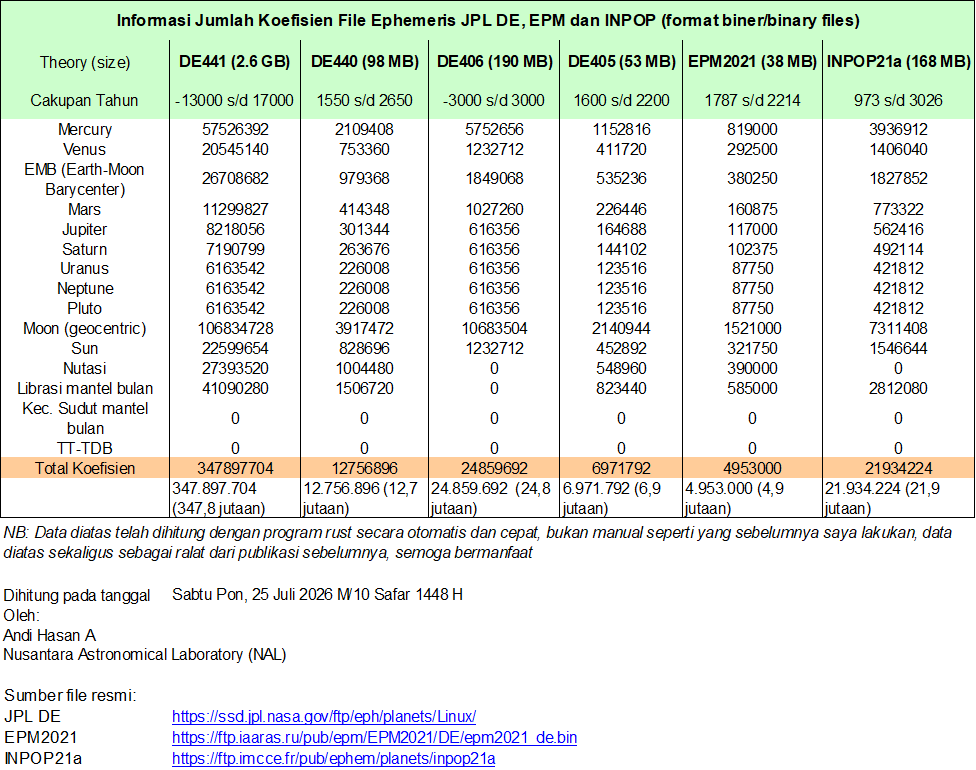

## Informasi File Biner Ephemeris

- Anda dapat mengunduh file biner di menu Pengaturan -> Kelola File Biner -> Unduh.
- File biner diambil dari situs resmi JPL NASA dan IAARAS Rusia, 
  JPL DE440 di: https://ssd.jpl.nasa.gov/ftp/eph/planets/Linux/de440/linux_p1550p2650.440 
  JPL DE406 di: https://ssd.jpl.nasa.gov/ftp/eph/planets/Linux/de406/lnxm3000p3000.406 
  JPL DE405 di: https://ssd.jpl.nasa.gov/ftp/eph/planets/Linux/de405/lnxp1600p2200.405 
  EPM2021 IAARAS di: https://ftp.iaaras.ru/pub/epm/EPM2021/DE/epm2021_de.bin
 
Pastikan koneksi internet stabil dan cepat (file biner rawan rusak) saat mengunduh, jika rusak silakan hapus dan ulangi mengunduh file biner. File biner tersebut tidak akan hilang saat melakukan update versi aplikasi, kecuali anda menghapusnya/meng-uninstall aplikasi.

### Jumlah Koefisien File Biner Ephemeris

  

### Cakupan Waktu

Cakupan waktu 
> - JPL DE440: 21 Des 1549 sampai 25 Jan 2650 
> - JPL DE406: 23 Feb -3000 sampai 06 Mei 3000 
> - JPL DE405: 9 Des 1599 sampai 20 Feb 2201 
> - IAARAS EPM2021: 10 Sep 1787 sampai 22 Okt 2214

## Format

Untuk mempersingkat tampilan, angka ditampilkan tanpa nol yang tidak diperlukan di akhir bagian desimal. 
Contoh:
> - 1.60 ditampilkan sebagai 1.6 
> - 12.340 ditampilkan sebagai 12.34

Penghilangan nol di akhir desimal tidak mengubah nilai angka.
Sebaliknya, nol yang berada setelah koma dan sebelum digit pertama yang bukan nol,
tetap dipertahankan karena mempengaruhi nilai angka:
> - 1.06 berbeda dengan 1.6 
> - 0.07 berbeda dengan 0.7

## Notasi Ilmiah

Nilai yang sangat besar atau sangat kecil dapat ditampilkan dalam notasi ilmiah menggunakan huruf/simbol E. 

Cara yang paling mudah membaca notasi ilmiah: 

Huruf E menunjukkan pergeseran koma/titik desimal. E positif berarti geser ke kanan, sedangkan E negatif berarti geser ke kiri, jumlah pergeseran sesuai nilai setelah simbol E. 
Contoh:
> - 1.4962375E6 = 1496237.5
> - 1.23E-4 = 0.000123
> - -1.37E-6 = -0.00000137

## Penggunaan

- Aplikasi memerlukan izin untuk mengaktifkan lokasi dan disarankan menggunakan internet.
- Waktu sholat halaman depan sudah ditambah ihtiyat 2 menit kecuali zuhur ditambah 3 menit, terbit dikurangi 2 menit,
  sedangkan tengah malam, rashdul qiblat 1 &amp; 2 dll, tidak ditambah/dikurangi.
- Pembulatan detik: 
> 1. Normal (lebih/sama dengan 30 detik dibulatkan menjadi 1 menit, kurang dari 30 detik diabaikan)
> 2. Ke Atas (Berapapun nilai detik, dibulatkan menjadi 1 menit)
> 3. Ke Bawah (Berapapun nilai detik, diabaikan/tidak dibulatkan ke menit).

- Khusus untuk algoritma/model JPL DE dan EPM IAARAS, tidak ada data Earth Heliosentris, karena untuk mengetahui data matahari geosentris dapat langsung menggunakan korelasi data: Sun Barycenter, EMB, dan Moon Geocentric.
- Anda bisa langsung melihat posisi lokasi anda di map dengan menekan ikon lokasi pada tampilan
  halaman depan/home saat lokasi telah terdeteksi.
- Jika terjadi crash &amp; aplikasi menampilkan laporan log crash, harap untuk menyalin &amp;
  membagikan log crash ke developer/pengembang, anda juga bisa melaporkan bug/kesalahan lainnya.
- Semua file yang dihasilkan dari fitur bagikan file baik .txt .png dan .pdf akan tersimpan di: storage/emulated/0/Download/Kanzul Falak/, jika dirasa sudah terlalu banyak anda bisa menghapusnya menggunakan aplikasi file manager.

## Pengakuan/Acknowlegdement

*Karya ini hanya mengambil dan menggunakan file biner/binary files dari situs web dan/atau layanan yang disediakan oleh Institut Astronomi Terapan dari Akademi Ilmu Pengetahuan Rusia &amp; Jet Propulsion Laboratory NASA. Untuk dibaca &amp; diolah sendiri datanya di aplikasi ini (bukan API).*

## Kontak

- Anda bisa menemukan kontak developer (Telegram/Email) di halaman "Tentang" klik ikon Telegram/Email.
- Gabung ke grup diskusi publik Ilmu Falak Hisab klik ikon Telegram.
- Temukan informasi pemrograman & falak hisab di channel YouTube & Instagram kami.
